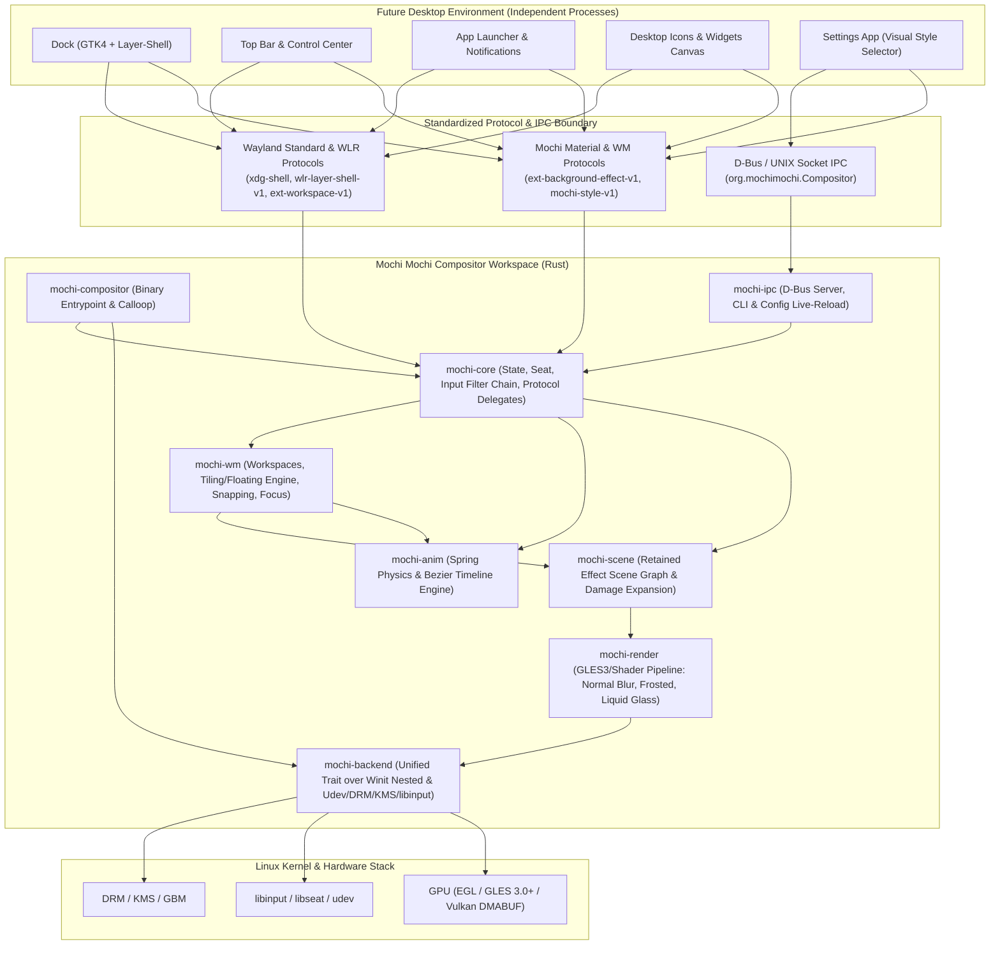
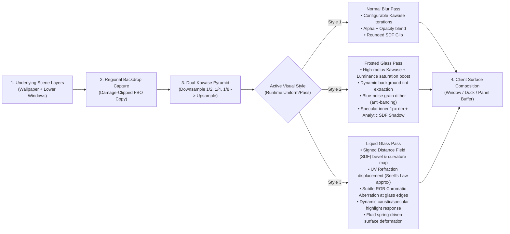
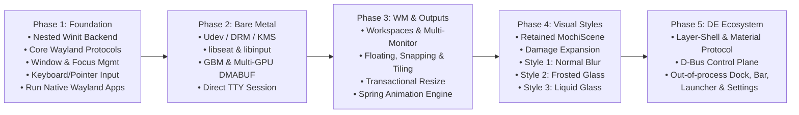

# Mochi Mochi — Architecture & Ecosystem Technical Report

> [!IMPORTANT]
> **Scope & Epistemic Distinction**: Throughout this report, **Verified Facts** (documented behaviors, source architectures, protocols, and licenses of existing projects) are explicitly separated from **Architectural Recommendations** (design proposals tailored for **Mochi Mochi**). In accordance with Section 1 & Section 8 of the specification, **Mochi Mochi** refers strictly to the Wayland compositor and window manager, decoupled from the future Desktop Environment (DE).

---

## 1. Analysis of Existing Wayland Compositors

### 1.1. Hyprland
* **Official Repository**: `https://github.com/hyprwm/Hyprland` | **Backend**: `https://github.com/hyprwm/aquamarine`
* **License**: BSD-3-Clause

| Dimension | Verified Technical Implementation |
| :--- | :--- |
| **1. Language** | C++23 (heavily modernized C++ with custom memory/pointer utilities in `hyprutils`). |
| **2. Libraries / Frameworks** | Historically built on `wlroots`; since v0.42+, migrated to its own stack: **Aquamarine** (backend), **hyprwayland-scanner** (C++ protocol codegen), **hyprlang** (config), **hyprcursor**, **pixman**, **libinput**, **libdrm**, **gbm**, **cairo/pango**. |
| **3. Window Management** | Pluggable layout interface (`IHyprLayout`) supporting **Dwindle** (binary space partitioning) and **Master** layouts, plus per-window floating, pseudotiling, window groups (tabbed stacks), and rule-based window matching. |
| **4. Workspaces** | Dynamic ID-based and named workspaces, plus "special" (scratchpad) workspaces. Workspaces bind to monitors dynamically and support swipe gestures. |
| **5. Multi-Monitor** | Independent workspace sets per monitor (or shared/migrated on hotplug), arbitrary scale factors (fractional scaling via `wp-fractional-scale-v1`), per-output refresh rates and VRR (Adaptive Sync). |
| **6. Animations & Effects** | Central `CAnimationManager` using `CAnimatedVariable<T>` templates driven by custom cubic Bezier curves. Damage-tracked effects include Dual-Kawase blur, drop shadows, rounded corners, and gradient borders. |
| **7. Composition & Rendering** | Custom OpenGL ES 3.x pipeline (`CHyprOpenGLImpl`) with explicit damage tracking (`pixman_region32_t`). Uses framebuffers per output and off-screen FBO chains for multi-pass shaders (blur passes,xray optimization for floating windows). |
| **8. Input Management** | `CInputManager` consumes events from Aquamarine's `libinput` backend, routing through `xkbcommon` for keyboards, custom pointer acceleration/confinement, and 1:1 touchpad gesture state machines. |
| **9. Wayland Protocols** | Native C++ protocol implementations generated via `hyprwayland-scanner` (`CWaylandProtocol`), supporting `xdg-shell`, `wlr-layer-shell-unstable-v1`, `linux-dmabuf-v1`, `linux-drm-syncobj-v1` (Explicit Sync), and `ext-workspace-v1`. |
| **10. Reference Features for Mochi Mochi** | **1)** `CAnimatedVariable` reactive property interpolation; **2)** Dual-Kawase multi-pass FBO pyramid with "xray" static background caching; **3)** Clean separation of low-level backend (`aquamarine`) from compositor policy. |

---

### 1.2. Sway
* **Official Repository**: `https://github.com/swaywm/sway` | **Framework**: `https://gitlab.freedesktop.org/wlroots/wlroots`
* **License**: MIT

| Dimension | Verified Technical Implementation |
| :--- | :--- |
| **1. Language** | C11. |
| **2. Libraries / Frameworks** | **wlroots** (`libwlroots`), **wayland-server**, **pixman**, **json-c** (IPC), **cairo/pango** (titlebars), **libinput**, **xkbcommon**. |
| **3. Window Management** | Manual n-ary tree structure (`sway_node` -> `sway_output` -> `sway_workspace` -> `sway_container` -> `sway_view`). Containers hold horizontal/vertical splits, tabs, or stacks, plus a separate floating container list per workspace. |
| **4. Workspaces** | Nodes in the tree directly below outputs. Created on demand, movable across outputs, and exposed over `sway-ipc`. |
| **5. Multi-Monitor** | Managed via `wlr_output_layout`. Each output owns its active workspace and renders at its own refresh rate and scale factor. |
| **6. Animations & Effects** | Intentionally omitted in upstream Sway (zero animations, no blur/rounded corners). Third-party fork **SwayFX** replaces `wlr_scene` with **SceneFX** (`wlrfx/scenefx`) to add blur, shadows, and corner rounding. |
| **7. Composition & Rendering** | Retained-mode scene graph using **`wlr_scene`**. Window state changes update scene nodes (`wlr_scene_tree`, `wlr_scene_buffer`, `wlr_scene_rect`); `wlr_scene` automatically computes minimal damage regions and dispatches to `wlr_renderer` (GLES2, Vulkan, or Pixman) or direct KMS planes. |
| **8. Input Management** | `sway_input_manager` wraps `wlr_seat`, `wlr_cursor`, `wlr_keyboard_group`, and `wlr_tablet_v2`, mapping bindings via `xkbcommon` keysyms. |
| **9. Wayland Protocols** | Delegated almost entirely to `wlroots` (`wlr_xdg_shell`, `wlr_layer_shell_v1`, `wlr_foreign_toplevel_management_v1`, etc.). |
| **10. Reference Features for Mochi Mochi** | **1)** Retained scene graph (`wlr_scene`) that decouples tree mutations from damage calculation and hardware scanout; **2)** Transactional window configuration (`sway_transaction`) that waits for client buffer commits before applying layout changes to prevent visual flicker. |

---

### 1.3. Wayfire
* **Official Repository**: `https://github.com/WayfireWM/wayfire`
* **License**: MIT

| Dimension | Verified Technical Implementation |
| :--- | :--- |
| **1. Language** | C++17. |
| **2. Libraries / Frameworks** | **wlroots**, **wf-config** (XML/INI config library), **glm** (3D math), **GLES3/EGL**, **cairo**, **pango**. |
| **3. Window Management** | Nearly 100% plugin-driven (`wf::plugin_interface_t`). Core provides a 2D/3D scene graph and view abstractions (`wf::view_interface_t`); plugins implement tiling (`simple-tile`), floating (`move`, `resize`), grid snapping (`grid`), and exposé (`scale`). |
| **4. Workspaces** | Implemented as a 2D contiguous grid (`wf::workspace_set_t`) per output, allowing smooth 2D/3D camera viewport panning (Desktop Wall, 3D Cube). |
| **5. Multi-Monitor** | Each `wf::output_t` runs an independent plugin pipeline, workspace set, and render loop (`wf::render_manager`). |
| **6. Animations & Effects** | Built-in `wf-utils` duration/timed transition helpers + custom OpenGL ES 3.0 shaders. Supports wobbly windows (spring mesh deformation), fire/burn particles, 3D cube rotation, and 4 different blur algorithms (Box, Gaussian, Kawase, Bokeh). |
| **7. Composition & Rendering** | Custom hierarchical scene graph (`wf::scene::node_t`) with **render hooks** (`wf::effect_hook_t`: pre-hook, post-hook, overlay-hook) and node-level render instances that can transform geometry or wrap child nodes in off-screen FBOs (`wf::auxilliary_buffer_t`). |
| **8. Input Management** | Routes `wlroots` input events through a grab interface (`wf::input_grab_t`), allowing plugins (like 3D cube or window move) to intercept raw pointer/touch/gesture streams cleanly. |
| **9. Wayland Protocols** | Uses `wlroots` protocol implementations alongside custom Wayfire shell/IPC protocols (`wayfire-shell`, JSON UNIX socket IPC). |
| **10. Reference Features for Mochi Mochi** | **1)** Scene-graph node wrapping (`transformer_node_t`) for composable post-processing effects (blur, refraction, shadows) without polluting core window logic; **2)** Input grab abstraction for modal interactions and gestures. |

---

### 1.4. River
* **Official Repository**: `https://codeberg.org/river/river`
* **License**: GPL-3.0-only

| Dimension | Verified Technical Implementation |
| :--- | :--- |
| **1. Language** | Zig. |
| **2. Libraries / Frameworks** | **wlroots** (via `zig-wlroots`), **wayland**, **pixman**, **xkbcommon**, **libevdev**. |
| **3. Window Management** | **Protocol-decoupled architecture**: River v0.3 used `river-layout-v3` (external layout generator); River v0.4+ uses **`river-window-management-v1`**, delegating all window management policy (tiling, floating, focus, stacking, keybindings) to an external process. |
| **4. Workspaces** | Historically used a 32-bit bitmask ("tags") per output and view; under `river-window-management-v1`, workspaces/tags are purely a concept owned by the external Window Manager process. |
| **5. Multi-Monitor** | Core tracks physical outputs via `wlr_output_layout` and exposes them to the external WM process as `river_output_v1` objects. |
| **6. Animations & Effects** | Minimal in core; external window managers can interpolate window positions/dimensions per frame during the synchronized render sequence. |
| **7. Composition & Rendering** | Uses `wlr_scene` with strict two-phase synchronization (**Manage Sequence** -> `manage_finish` -> client `configure`/`commit` -> **Render Sequence** -> `render_finish`) to guarantee atomic, tear-free frames across process boundaries. |
| **8. Input Management** | Core handles low-level `libinput`/`wlr_seat` routing, pointer constraints, and forwards registered keybindings/pointer ops to the WM via protocol events. |
| **9. Wayland Protocols** | `wlroots` protocols + custom `river-window-management-v1` and `river-layer-shell-v1`. |
| **10. Reference Features for Mochi Mochi** | **1)** Explicit separation of **Mechanism** (compositor core) vs. **Policy** (window management); **2)** Two-phase Manage/Render transaction model to synchronize window state changes with client buffer commits. |

---

### 1.5. Niri
* **Official Repository**: `https://github.com/YaLTeR/niri`
* **License**: GPL-3.0-or-later

| Dimension | Verified Technical Implementation |
| :--- | :--- |
| **1. Language** | Rust. |
| **2. Libraries / Frameworks** | **Smithay**, **calloop** (event loop), **knuffel** (KDL configuration parser), **pangocairo** (titlebars/text), **libudev**, **gbm**, **drm**. |
| **3. Window Management** | **Scrollable-tiling**: windows are arranged in an infinite horizontal ribbon of columns per workspace. Columns can contain single windows, vertical splits, or tabbed stacks, alongside a floating layer. |
| **4. Workspaces** | Dynamic vertical stack of scrollable workspaces per monitor (inspired by GNOME's dynamic workspaces + PaperWM's horizontal strip). |
| **5. Multi-Monitor** | Fully independent workspace stacks per monitor (`MonitorSet`). Each monitor maintains its own viewport camera, scale, and refresh cycle. |
| **6. Animations & Effects** | First-class physical **spring animations** (damped harmonic oscillator) and cubic easing for every camera pan, window resize, workspace switch, and zoomed-out **Live Overview**; supports custom GLSL user shaders for window open/close/resize. |
| **7. Composition & Rendering** | Built on Smithay's `Renderer` traits (`GlesRenderer` + `MultiRenderer` for multi-GPU). Uses Smithay's `RenderElement` trait hierarchy to compose surfaces, solid color rects, shadows, clipped rounded corners (custom GLSL shaders), and screencast buffers. |
| **8. Input Management** | Uses Smithay's `LibinputInputBackend` (on TTY) or `Winit` (nested), with custom touchpad 1:1 gesture trackers driving spring physics directly. |
| **9. Wayland Protocols** | Uses Smithay's protocol delegates (`xdg-shell`, `wlr-layer-shell`, `ext-workspace`, `xdg-activation`, `wp-viewporter`, `wp-fractional-scale`, `linux-dmabuf`). |
| **10. Reference Features for Mochi Mochi** | **1)** Idiomatic Rust + Smithay codebase organization (`niri_config`, `niri_ipc`, `layout`, `render_helpers`); **2)** Custom `RenderElement` wrappers in Smithay for custom GLSL shaders, rounded corner clipping, and offscreen texture rendering; **3)** Physical spring animation engine coupled to 1:1 touchpad gestures. |

---

### 1.6. COSMIC (`cosmic-comp`)
* **Official Repository**: `https://github.com/pop-os/cosmic-comp`
* **License**: GPL-3.0-only

| Dimension | Verified Technical Implementation |
| :--- | :--- |
| **1. Language** | Rust. |
| **2. Libraries / Frameworks** | **Smithay**, **calloop**, **libcosmic** / **iced** (for server-side UI elements like tiling drag overlays and SSD headers), **cosmic-config**, **xkbcommon**, **pixman**. |
| **3. Window Management** | Dual-mode hybrid engine (`Shell` struct): supports full floating stacking mode and automatic binary-tree tiling mode switchable **per workspace** at runtime, plus window stacking/tabbing (`CosmicMapped`) and sticky windows. |
| **4. Workspaces** | Configurable as either ** Monitor-bound** (independent workspaces per screen) or **Global/Spanning** (workspaces switch all monitors simultaneously), exposed via `cosmic-workspace-unstable-v1` and `ext-workspace-v1`. |
| **5. Multi-Monitor** | Advanced multi-GPU and multi-output pipeline using Smithay's `MultiRenderer` and DMABUF format negotiations across primary and secondary DRM nodes. |
| **6. Animations & Effects** | Interpolated layout transitions, rounded corners, drop shadows, active window outlines, and frosted-style blur integration for layer-shell panels/applets. |
| **7. Composition & Rendering** | Extends Smithay's `GlesRenderer` and `GlowRenderer` (`glow` OpenGL bindings) to render both standard Wayland client surfaces and internal `iced` UI widgets (`iced_tiny_skia` / GPU buffers) into a unified `RenderElement` slice. |
| **8. Input Management** | Smithay `Seat` + `LibinputInputBackend`, custom gesture recognizers, XKB configuration synced dynamically via `cosmic-config`. |
| **9. Wayland Protocols** | Smithay standard protocols + custom `cosmic-workspace`, `cosmic-toplevel-info`, `cosmic-toplevel-management`, `cosmic-output-management`, and `xdg-Desktop-Portal` screencopy integration. |
| **10. Reference Features for Mochi Mochi** | **1)** Clean boundary between `cosmic-comp` (compositor) and out-of-process DE components (`cosmic-panel`, `cosmic-applets`, `cosmic-launcher`, `cosmic-settings`) communicating strictly via Wayland protocols (`layer-shell`, `ext-workspace`, `foreign-toplevel`) and config files; **2)** Hybrid floating + tiling architecture. |

---

### 1.7. KWin (KDE Plasma)
* **Official Repository**: `https://invent.kde.org/plasma/kwin`
* **License**: GPL-2.0-or-later

| Dimension | Verified Technical Implementation |
| :--- | :--- |
| **1. Language** | C++20. |
| **2. Libraries / Frameworks** | **Qt6** (QtCore, QtGui, QtQuick/QML), **KWayland** (internal to KWin in Plasma 6), **libdrm**, **gbm**, **libinput**, **lcms2** (color management), **PipeWire**. |
| **3. Window Management** | Stacking window manager (`Workspace` class managing `Window` subclasses: `XdgToplevelWindow`, `X11Window`, `LayerShellV1Window`) coupled with a Quick Tile / Custom Tiling layout engine (`TileManager`) and QML scripting API. |
| **4. Workspaces** | Virtual Desktops (1D/2D grid) + KDE Activities, orthogonal to physical outputs or per-output in custom configurations. |
| **5. Multi-Monitor** | Deep DRM/KMS atomic modesetting pipeline with per-output color profiles (ICC/HDR10), fractional scaling, and hardware plane overlays. |
| **6. Animations & Effects** | `EffectsHandler` & `Effect` plugin system (`BlurEffect`, `ContrastEffect`, `SlidingPopups`, `WobblyWindows`, `MagicLamp`). `BlurEffect` uses Dual-Kawase downscale/upscale passes + optional noise texture overlay for frosted glass. |
| **7. Composition & Rendering** | Retained Scene Graph (`WorkspaceScene` -> `Item` tree: `WindowItem`, `SurfaceItem`, `ShadowItem`) rendered via `RenderBackend` (OpenGL, QPainter). Explicitly separates logical `Item` hierarchy from `RenderTarget` and `RenderLayer`. |
| **8. Input Management** | Filter-chain architecture (`InputEventFilter` pipeline): raw `libinput` events pass through ordered filters (ScreenLocker -> GlobalShortcuts -> Effects -> MoveResize -> Decoration -> Window). |
| **9. Wayland Protocols** | Comprehensive suite including `kde-blur-v1` (`org_kde_kwin_blur_manager`), `kde-slide`, `ext-background-effect-v1`, HDR/color management (`wp-color-management-v1`), and XWayland. |
| **10. Reference Features for Mochi Mochi** | **1)** Ordered **Input Event Filter Chain** (`InputEventFilter`) — an extraordinarily clean pattern for routing input through lockscreens, gestures, overlays, and windows; **2)** `Item` vs. `ShadowItem` scene graph design; **3)** KWin's Frosted Glass blur implementation (Dual-Kawase + procedural/texture noise dither to prevent color banding). |

---

### 1.8. Mutter (GNOME)
* **Official Repository**: `https://gitlab.gnome.org/GNOME/mutter`
* **License**: GPL-2.0-or-later

| Dimension | Verified Technical Implementation |
| :--- | :--- |
| **1. Language** | C99 (with GObject object-oriented system). |
| **2. Libraries / Frameworks** | **GLib / GObject / GIO**, internal forks of **Clutter** (scene graph & animation) and **Cogl** (GPU abstraction over GLES3/GL), **libinput**, **libdrm**, **gbm**, **PipeWire**, **graphene** (SIMD math). |
| **3. Window Management** | Stacking window manager (`MetaDisplay`, `MetaWindow`) with edge tiling; tightly coupled to `gnome-shell` (which runs in the **same process** via GJS/SpiderMonkey JavaScript bindings). |
| **4. Workspaces** | Dynamic vertical/horizontal workspace list (`MetaWorkspaceManager`), primary-monitor-only by default or spanning all monitors. |
| **5. Multi-Monitor** | `MetaMonitorManager` + `MetaKms` (runs KMS atomic commits on a dedicated real-time kernel thread in recent releases for low-latency cursor and page-flips). |
| **6. Animations & Effects** | Clutter actor transitions (`ClutterPropertyTransition`, `ClutterTimeline`) and `ClutterEffect` subclasses (`ClutterOffscreenEffect`, `ClutterShaderEffect`, `ClutterBlurEffect`). |
| **7. Composition & Rendering** | Retained actor tree (`ClutterStage` -> `MetaWindowGroup` -> `MetaWindowActor` -> `MetaSurfaceActor` -> `MetaShapedTexture`). Uses frame-clock scheduling driven by display VBlank with triple-buffering scaling when GPU load spikes. |
| **8. Input Management** | `ClutterSeat` + `libinput` on a dedicated input thread, dispatching events to the main thread or updating hardware cursor planes directly on the KMS thread. |
| **9. Wayland Protocols** | Custom GObject Wayland implementation (`MetaWaylandCompositor`); notoriously rejects `wlr-layer-shell` because `gnome-shell` lives in-process. |
| **10. Reference Features for Mochi Mochi** | **1)** Frame-clock scheduling and dynamic triple-buffering for butter-smooth animations on integrated GPUs; **2)** **Anti-pattern warning**: embedding the entire Desktop Environment shell (`gnome-shell` via JS) in the same process as the compositor couples DE crashes and GC pauses directly to display composition—validating Mochi Mochi's strict architectural requirement to keep the DE out-of-process. |

---

### 1.9. Anvil (Smithay Reference)
* **Official Repository**: `https://github.com/Smithay/smithay/tree/master/anvil`
* **License**: MIT

| Dimension | Verified Technical Implementation |
| :--- | :--- |
| **1. Language** | Rust. |
| **2. Libraries / Frameworks** | **Smithay** (same workspace), **calloop**, **winit**, **x11rb**, **drm**, **gbm**, **libinput**, **tracing**. |
| **3. Window Management** | Simple floating stacking window manager built on `smithay::desktop::Space<WindowElement>`. Supports basic window move, resize, and server-side/client-side decorations. |
| **4. Workspaces** | Minimal single-space demonstration (shows how `Space<E>` maps multiple outputs into a 2D global coordinate plane). |
| **5. Multi-Monitor** | Maps `smithay::output::Output` instances onto `Space`, demonstrating fractional scale and output damage tracking (`OutputDamageTracker`). |
| **6. Animations & Effects** | None (renders raw buffers and solid rectangles). |
| **7. Composition & Rendering** | Demonstrates `smithay::backend::renderer::damage::OutputDamageTracker` composing `RenderElement` slices across `winit` (nested), `x11` (nested), and `udev` (DRM/KMS + GBM + MultiRenderer) backends. |
| **8. Input Management** | Demonstrates generic `InputBackend` event processing (`process_input_event`) unified across nested Winit events and bare-metal `libinput` events. |
| **9. Wayland Protocols** | Canonical example of Smithay's `delegate_xdg_shell!`, `delegate_layer_shell!`, `delegate_shm!`, `delegate_dmabuf!`, `delegate_seat!`, and `delegate_output!` macros. |
| **10. Reference Features for Mochi Mochi** | **1)** Blueprint for our **Phase 1 Minimal Compositor**: shows how to abstract `BackendData` via a Rust trait so the exact same `MochiState` logic runs nested inside `winit` during development and on `udev`/DRM/KMS on bare metal. |

---

### 1.10. Jay
* **Official Repository**: `https://github.com/mahkoh/jay`
* **License**: GPL-3.0-only

| Dimension | Verified Technical Implementation |
| :--- | :--- |
| **1. Language** | Rust. |
| **2. Libraries / Frameworks** | Custom in-tree crates by `mahkoh` (no Smithay, no `wlroots`, no `wayland-rs`): custom wire protocol scanner, custom `io_uring` async event loop, **ash** (Vulkan), **EGL/GLES2**, **libinput**, **libdrm**, **gbm**. |
| **3. Window Management** | Manual `i3`-style tree tiling (containers with horizontal/vertical splits, tabs, stacked, floating). |
| **4. Workspaces** | Named workspaces bound to outputs with automatic migration and restoration on monitor hot-plug/unplug. |
| **5. Multi-Monitor** | Multi-GPU routing and hotplug workspace memory. |
| **6. Animations & Effects** | Minimal/none (focuses on ~1.5ms ultra-low input latency and instant tiling). |
| **7. Composition & Rendering** | First-class **Vulkan** renderer (via `ash`) with an OpenGL ES fallback, supporting native `linux-drm-syncobj-v1` explicit synchronization. |
| **8. Input Management** | Direct `libinput` + `xkbcommon` integration driven by its custom `io_uring` async runtime. |
| **9. Wayland Protocols** | Custom Rust wire-protocol implementation featuring a strict security split between **Unprivileged** protocols (exposed to all clients) and **Privileged** protocols (requiring explicit capability/CLI authorization via `wl-proxy`). |
| **10. Reference Features for Mochi Mochi** | **1)** Security partitioning between **Privileged** (DE components: dock, panel, settings, screencopy) and **Unprivileged** Wayland clients; **2)** Built-in client wire-protocol tracing (`jay trace`) and runtime CLI introspection. |

---

### 1.11. Other High-Value Ecosystem Projects Discovered

1. **Louvre (`CuarzoSoftware/Louvre`)** — *C++20 / LGPL-2.1*:
   * **Fact**: A C++ library for building Wayland compositors specifically engineered around macOS/visionOS-like visual effects (`LBlurView`, `LBackgroundBlur`, `LPainter`, damage-expanded regional blur, and rounded clipping).
   * **Relevance to Mochi Mochi**: Louvre's mathematical formulation for **regional background blur damage expansion** (whenever a pixel underneath a blurred/refracted surface changes, the damage region must expand by the blur kernel radius before sampling and clipping to the blurred surface's region) is directly applicable to our **Normal Blur**, **Frosted Glass**, and **Liquid Glass** architecture.
2. **SceneFX (`wlrfx/scenefx`)** — *C11 / MIT*:
   * **Fact**: A drop-in replacement for `wlr_scene` that enriches scene-graph nodes with Dual-Kawase blur, corner radii, and analytic SDF drop shadows.
   * **Relevance to Mochi Mochi**: Demonstrates how to embed analytic box shadows (computed in a single fragment shader pass without texture blurs) and stencil/SDF rounded corners directly into a retained scene graph.
3. **Gamescope (`ValveSoftware/gamescope`)** — *C++20 / BSD-2-Clause*:
   * **Fact**: Valve's Vulkan-only micro-compositor that utilizes Vulkan compute shaders and direct DRM/KMS plane composition.
   * **Relevance to Mochi Mochi**: Reference for direct scanout bypass (bypassing composition completely when a fullscreen game or video covers an output).

---

## 2. Architectural Comparisons

### 2.1. Core Architecture & Rendering Matrix

| Compositor | Stack / Foundation | Process Model | Scene Architecture | Primary GPU API | License |
| :--- | :--- | :--- | :--- | :--- | :--- |
| **Hyprland** | Aquamarine (C++) | Monolithic + IPC | Immediate + Damage Tracker | OpenGL ES 3.x | BSD-3-Clause |
| **Sway** | wlroots (C) | Monolithic + IPC | Retained (`wlr_scene`) | GLES2 / Vulkan | MIT |
| **Wayfire** | wlroots (C++) | Core + C++ Plugins | Retained Node Graph + Hooks | OpenGL ES 3.0+ | MIT |
| **River** | wlroots (Zig) | Split (Core + External WM) | Retained (`wlr_scene`) | GLES2 / Vulkan | GPL-3.0 |
| **Niri** | Smithay (Rust) | Monolithic + IPC | `RenderElement` Composition | OpenGL ES 2.0/3.0 | GPL-3.0 |
| **COSMIC** | Smithay (Rust) | Modular DE + Compositor | `RenderElement` + Glow | OpenGL ES / Glow | GPL-3.0 |
| **KWin** | Qt6 / Custom (C++) | Monolithic + Effects Plugins | Retained (`WorkspaceScene`) | OpenGL / QPainter | GPL-2.0+ |
| **Mutter** | Clutter / Cogl (C) | Monolithic (Shell in-process) | Retained (`ClutterStage`) | OpenGL ES 3 / GL | GPL-2.0+ |
| **Jay** | Custom (Rust) | Monolithic + CLI / SO | Custom Render Tree | Vulkan + GLES2 | GPL-3.0 |
| **Mochi Mochi (Proposed)** | **Smithay (Rust)** | **Modular Crates + Out-of-Process DE** | **Retained Effect Scene Graph (`MochiScene`)** | **GLES 3.0+ (Vulkan/wgpu ready)** | **MIT / Apache-2.0 or GPL-3.0** |

### 2.2. Key Architectural Trade-offs

1. **In-Process Shell (Mutter/GNOME) vs. Out-of-Process Shell (`cosmic-comp`, Sway, Hyprland)**:
   * *Fact*: Mutter embeds `gnome-shell` inside the compositor process. If a shell widget leaks memory or blocks the main thread, the entire display freezes or crashes, terminating all user applications.
   * *Recommendation*: Mochi Mochi **must** strictly enforce out-of-process boundaries for all Desktop Environment components (Dock, Top Bar, Launcher, Notification Center, Desktop Icons/Widgets, Settings). They will interact with Mochi Mochi via standardized Wayland protocols (`wlr-layer-shell-unstable-v1`, `ext-workspace-v1`, `ext-foreign-toplevel-list-v1`, `ext-background-effect-v1`) and a dedicated Mochi IPC/Wayland extension for visual style selection.
2. **Immediate `RenderElement` Assembly (Anvil/Niri) vs. Retained Effect Scene Graph (KWin/Wayfire/SceneFX)**:
   * *Fact*: Smithay's default `Space<WindowElement>` flattens elements into a `Vec<RenderElement>` every frame. While great for simple 2D stacking, multi-pass visual effects like **Frosted Glass** (which must sample blurred background content behind specific layers) and **Liquid Glass** (which requires surface normal/SDF refraction of underlying layers) become cumbersome if the scene is just a flat list.
   * *Recommendation*: Build a lightweight **Retained Effect Scene Graph (`mochi-scene`)** on top of Smithay's `OutputDamageTracker` and `GlesRenderer`.

---

## 3. Identification of Reusable Libraries & Components

To avoid reinventing the wheel while maintaining full architectural independence, we audited the Rust and Linux ecosystem along with software licenses:

| Category | Crate / Library | License | Role in Mochi Mochi | Reuse Mode |
| :--- | :--- | :--- | :--- | :--- |
| **Wayland & Backend Core** | `smithay` | **MIT** | Wayland protocol server, DRM/KMS, GBM, libinput, XWayland, Seat, Damage tracking | Direct Dependency |
| **Wayland Wire Protocol** | `wayland-server`, `wayland-protocols`, `wayland-protocols-wlr` | **MIT** | Official & WLR Wayland XML bindings in pure Rust | Direct Dependency (via Smithay) |
| **Event Loop** | `calloop` | **MIT** | Callback-driven single-threaded epoll event loop with shared state passing | Direct Dependency |
| **Session & Seat** | `libseat` (`libseat-rs`) | **MIT** | Rootless TTY session management (`seatd` / `systemd-logind`) | Direct Dependency (via Smithay) |
| **Hardware Input** | `input` (`libinput`), `xkbcommon` | **MIT** | Touchpad gestures, pointer acceleration, keyboard layouts | Direct Dependency (via Smithay) |
| **GPU Math & Geometry** | `glam` | **MIT / Apache-2.0** | SIMD-accelerated 2D/3D vectors, matrices, and quaternions for animations & shaders | Direct Dependency |
| **Spring & Easing Physics** | Custom (~250 LOC inspired by Niri / `interpolation`) | **MIT / Apache-2.0** | Analytical damped harmonic oscillator (spring physics) + cubic Bezier curves | Independent Implementation |
| **IPC & DE Integration** | `zbus` | **MIT** | Pure-Rust async/sync D-Bus implementation for Settings, Portals, and DE services | Direct Dependency |
| **Configuration** | `serde` + `toml` or `knuffel` (KDL) | **MIT / Apache-2.0** | Declarative configuration parsing with hot-reload support | Direct Dependency |
| **Diagnostics & Logging** | `tracing`, `tracing-subscriber` | **MIT** | Structured, zero-overhead instrumentation and span profiling | Direct Dependency |

> [!WARNING]
> **License Compliance Boundary**:
> - **MIT / BSD-3-Clause projects** (*Smithay, Anvil, Sway, SceneFX, Hyprland, Aquamarine*): Permissive licenses; algorithms, shader math, and patterns can be adapted freely with attribution.
> - **GPL-3.0 / GPL-2.0 projects** (*Niri, cosmic-comp, Jay, River, KWin, Mutter*): Strong copyleft. If Mochi Mochi chooses a permissive license (MIT/Apache-2.0), we **must not** copy source code from GPL compositors; we may only study their architectural concepts and Wayland protocol flows and write clean, independent implementations. (If Mochi Mochi is licensed under GPL-3.0, code compatibility with GPLv3 projects is permitted, though clean modular design is still preferred).

---

## 4. Evaluation of Smithay for Mochi Mochi

### 4.1. Verified Facts About Smithay
1. **Toolkit, Not a Rigid Framework**: Unlike `Mutter` or `KWin`, Smithay does not force a specific window layout, configuration format, or effect pipeline. It provides modular building blocks (`backend`, `wayland`, `desktop`, `input`, `output`).
2. **Production-Proven**: Powers both **COSMIC (`cosmic-comp`)** (a full desktop environment compositor) and **Niri** (a high-framerate physics-driven compositor).
3. **Complete Backend Abstraction**:
   * **Nested Development**: `smithay::backend::winit` and `smithay::backend::x11` allow running the compositor inside a window on an existing Wayland/X11 desktop.
   * **Bare Metal Execution**: `smithay::backend::udev` + `drm` + `gbm` + `libseat` + `libinput` handle direct hardware scanout, atomic KMS commits, VRR, and multi-GPU `MultiRenderer` buffer transfers.
4. **Explicit & Implicit Sync + DMABUF**: Supports `linux-dmabuf-v1` (v4 device feedback) and `linux-drm-syncobj-v1` (explicit GPU synchronization essential for NVIDIA and modern Mesa drivers).

### 4.2. Architectural Assessment for Mochi Mochi's Visual Style System
* **Strength**: Smithay's `GlesRenderer` exposes raw OpenGL ES 3.0+ contexts (`with_context`), custom `GlesPixelProgram` / `GlesTexProgram` compilation, and off-screen `GlesTexture` framebuffer rendering (`Bind` / `Offscreen` traits).
* **Limitation**: Smithay's built-in `smithay::desktop::Space` is a simple 2D container designed for basic stacking and does not natively understand multi-pass background blur, backdrop refraction, or hierarchical group opacity.
* **Solution**: We will use Smithay for **all** low-level protocols, input, DRM/KMS, buffer management (`SHM`/`DMABUF`), and damage tracking (`OutputDamageTracker`), while implementing our own **`mochi-scene`** and **`mochi-render`** crates on top of Smithay's `GlesRenderer` to power Normal Blur, Frosted Glass, and Liquid Glass.

---

## 5. Comparison of Technological Alternatives

### 5.1. Primary Programming Language: Rust vs. C++23 vs. Zig
| Criterion | Rust (Recommended) | C++23 (Hyprland / KWin) | Zig (River) |
| :--- | :--- | :--- | :--- |
| **Memory & Thread Safety** | Compile-time ownership prevents use-after-free when clients disconnect mid-frame. | Prone to dangling surface/buffer pointers (major source of crash bugs in C++ compositors). | Manual memory management with debug safety checks; still pre-1.0 language spec. |
| **Wayland Ecosystem** | First-class (`smithay`, `wayland-rs`, `calloop`, `zbus`). | Mature (`wlroots` via C, `Aquamarine`, `Louvre`). | Relies on C bindings (`zig-wlroots`). |
| **Long-term Maintainability** | Strict module boundaries via Cargo workspaces and trait contracts. | Header/build complexity (CMake/Meson). | Fast compilation, but breaking compiler changes between 0.1x releases. |

### 5.2. Compositor Foundation: Smithay vs. Alternatives
* **Smithay (Rust)** vs. **wlroots (C via FFI)**: Wrapping `wlroots` in Rust (`wlroots-rs`) failed historically because `wlroots` relies on pervasive raw C pointers and intrusive linked lists (`wl_list`) that clash fundamentally with Rust's borrow checker. Smithay was designed from the ground up around Rust ownership and `calloop`.
* **Smithay (Rust)** vs. **From Scratch (like Jay)**: Writing DRM/KMS atomic modesetting, GBM buffer allocation, multi-GPU DMABUF feedback, and XWayland window management from scratch requires ~40,000+ lines of intricate hardware plumbing before writing a single window management or visual effect feature. **Verdict**: **Smithay** is overwhelmingly the optimal choice.

### 5.3. GPU Rendering API: OpenGL ES 3.0+ (`GlesRenderer`) vs. Vulkan / `wgpu`
* **Verified Fact**: In Smithay today, `GlesRenderer` (backed by EGL + GLES 3.0+ / `glow`) is the most mature, battle-tested renderer with full zero-copy `EGLImage` / `DMABUF` import/export. While Smithay has experimental Vulkan helpers and `wgpu` can share textures via raw Vulkan `VkImage` DMABUF extensions, `wgpu` does not natively expose all Linux DRM format modifiers needed for direct scanout and arbitrary client DMABUF imports out of the box.
* **Architectural Recommendation**:
  1. Design a trait-abstracted render pass interface in `mochi-render`.
  2. Implement the primary backend using **OpenGL ES 3.0+ (`GlesRenderer` / raw GLES3 via `glow`)**, which gives us full access to multi-pass Framebuffer Objects (FBOs), GLSL 300 es fragment shaders, mipmaps, and zero-copy DMABUF imports.
  3. Keep shader uniforms and render-pass descriptors API-agnostic so a Vulkan compute/graphics backend can be added later without changing `mochi-scene` or `mochi-wm`.

### 5.4. Future Desktop Environment Auxiliary Toolkit: GTK4 vs. Iced vs. Slint
Because the Desktop Environment (Dock, Top Bar, Launcher, Settings) will run as independent Wayland client processes, the compositor itself **does not depend on GTK4**. However, evaluating the toolkit for the future DE apps is critical now:
* **GTK4 (`gtk4-rs` + `gtk4-layer-shell`)**:
  * *Pros*: Mature accessibility, rich widget set, CSS styling, native fractional scaling in GTK 4.14+, rock-solid Wayland `wlr-layer-shell` support via `gtk4-layer-shell`, custom `GskGLShader` / Vulkan render nodes.
  * *Cons*: Client-side surfaces are opaque/alpha buffers; background blur and liquid refraction **behind** the dock/panel must still be composited by Mochi Mochi (triggered by the GTK4 app attaching our background-effect Wayland protocol to its `wl_surface`).
* **Iced (`iced` / `libcosmic`)**:
  * *Pros*: Pure Rust Elm-like architecture, lightweight.
  * *Cons*: Less mature text shaping/accessibility and animation tooling compared to GTK4.
* **Recommendation**: Decouple Mochi Mochi from any GUI toolkit. Expose a clean Wayland protocol extension (`ext-background-effect-v1` + `mochi-surface-material-v1`) so **GTK4** (or any Wayland client) can declare *"this surface region uses the active Mochi Visual Style (Normal Blur / Frosted Glass / Liquid Glass) with elevation $z$ and corner radius $r$"*, allowing Mochi Mochi's GPU pipeline to render the exact backdrop shader behind the GTK4 surface at full display refresh rate.

---

## 6. Proposed Modular Architecture for Mochi Mochi

### 6.1. System & Workspace Architecture Diagram



### 6.2. Cargo Workspace Crate Structure

To guarantee modularity and prevent spaghetti coupling, Mochi Mochi will be organized as a multi-crate Cargo workspace:

1. `crates/mochi-core`: Central `MochiState`, Wayland protocol handlers (`xdg-shell`, `layer-shell`, `shm`, `dmabuf`, `fractional-scale`, `viewporter`), `Seat` management, and KWin-inspired **Input Event Filter Chain** (`LockFilter` -> `GestureFilter` -> `KeybindFilter` -> `GrabFilter` -> `SurfaceFocusFilter`).
2. `crates/mochi-backend`: Clean trait abstraction (`MochiBackend`) isolating:
   * `winit_backend`: Nested Wayland/X11 execution for rapid desktop development.
   * `udev_backend`: Bare-metal DRM/KMS, `libseat`, `gbm`, `libinput`, and multi-GPU `MultiRenderer`.
3. `crates/mochi-wm`: Pure window management policy decoupled from rendering. Handles workspaces, multi-monitor output mapping, floating/snapping/tiling layouts, window rules, and transactional configure states.
4. `crates/mochi-anim`: Standalone animation library providing physical **Spring** solvers (damped harmonic oscillators that smoothly redirect when interrupted mid-flight) and **Cubic Bezier** timelines.
5. `crates/mochi-scene`: Retained-mode scene graph (`SceneNode`: `OutputRoot`, `LayerGroup`, `WindowNode`, `SurfaceTree`, `BackdropEffectNode`, `ShadowNode`) with automatic **blur/refraction damage expansion**.
6. `crates/mochi-render`: GPU shader pipeline and visual style engine implementing **Normal Blur**, **Frosted Glass**, and **Liquid Glass**.
7. `crates/mochi-ipc`: Configuration parser, CLI controller (`mochi-msg`), and D-Bus interface (`org.mochimochi.Compositor`) for runtime queries and instant visual style switching from the future DE Settings app.
8. `crates/mochi-compositor`: Lightweight binary entrypoint that wires the `calloop` event loop and launches the selected backend.

---

## 7. Rendering and Visual Effects Strategy

Mochi Mochi's defining visual feature is first-class, hardware-accelerated support for three selectable **Visual Styles** (**Normal Blur**, **Frosted Glass**, and **Liquid Glass**).

### 7.1. Why Naive Blur Fails in Compositors (And How Mochi Mochi Solves It)
In a damage-tracked Wayland compositor, only regions that changed (`damage`) are redrawn each frame. However, when a translucent window $W$ sits above a background window $B$:
* If a tiny cursor blinks inside $B$ at $(x, y)$, a blur or refraction shader on $W$ samples pixels within radius $R$ around $(x, y)$.
* If the compositor only redraws the 2×10px cursor damage box, the surrounding blurred pixels in $W$ will not update, causing severe visual artifacts (ghosting/tearing inside the glass).
* **The Mochi Scene Graph Solution (`Damage Expansion`)**:
  Whenever an underlying node produces damage $\mathcal{D}_{\text{under}}$ that intersects the bounding box of a `BackdropEffectNode` $E$ with kernel radius $R_{\text{eff}}$, `mochi-scene` expands the intersected damage region by $R_{\text{eff}}$:
  $$\mathcal{D}_{\text{expanded}} = \left(\mathcal{D}_{\text{under}} \oplus B(R_{\text{eff}})\right) \cap \text{Bounds}(E)$$
  where $\oplus B(R_{\text{eff}})$ denotes morphological dilation by the effect's sampling radius. This guarantees 100% artifact-free real-time blur and refraction while preserving near-zero GPU usage when the screen is idle.

### 7.2. Unified Material Pipeline Architecture



### 7.3. Technical Specification of the Three Official Visual Languages

#### Style 1: Normal Blur (`VisualStyle::NormalBlur`)
* **Target Profile**: Low GPU overhead, clean modern transparency, ideal for integrated GPUs or power-saving modes.
* **Shader Pipeline**:
  1. **Dual-Kawase Blur**: 2 downsample passes + 2 upsample passes using hardware bilinear filtering (samples 4–5 texels per pass, achieving a wide Gaussian-equivalent kernel at $<0.15\text{ ms}$ on modern iGPUs).
  2. **Composite Pass**: Blends the blurred FBO texture with the surface's configurable alpha level and clips to an anti-aliased Signed Distance Field (SDF) rounded rectangle.
  3. **Static Caching Optimization ("X-Ray" mode)**: Optional optimization where stationary windows cache blurred wallpaper regions when no dynamic windows move behind them.

#### Style 2: Frosted Glass (`VisualStyle::FrostedGlass`)
* **Target Profile**: Tactile, diffused acrylic/frosted aesthetic where wallpaper colors and underlying light bleed richly through surfaces with depth and subtle borders.
* **Shader Pipeline**:
  1. **Deep Dual-Kawase Pyramid + Mipmap Average**: 3 to 4 Kawase passes plus a high-mip sample to extract the local ambient color tone of the background behind the window/dock.
  2. **Color & Luminance Grading (HSV/OKLab space)**: Boosts background chroma saturation slightly while clamping extreme highlights/shadows so foreground text remains legible regardless of how bright or dark the background is.
  3. **Procedural Blue-Noise Frosted Grain**: Applies a subtle high-frequency tiled noise texture (`1/255` to `3/255` dithering + micro-frost texture) to eliminate 8-bit color banding and give a physical sandblasted glass feel.
  4. **Analytic SDF Shadow & Specular Rim**: Renders a soft multi-layered drop shadow via an analytic box-shadow SDF outside the window bounds, plus a directional 1px inner specular highlight border (brighter on top/left edges, subtle on bottom/right) to create physical elevation depth.

#### Style 3: Liquid Glass (`VisualStyle::LiquidGlass`)
* **Target Profile**: High-craft, fluid optical material featuring real-time refraction, curved glass edges, specular reflections, and responsive motion.
* **Shader Pipeline**:
  1. **Variable-Density Backdrop Sampling**: Samples both a sharp/low-blur backdrop mip and a diffused backdrop mip.
  2. **Analytic SDF Bevel & Surface Normal Generation**: For any rounded surface (windows, dock, control center panels, widgets), computes the signed distance $d$ from the rounded boundary in the fragment shader and derives a smooth 3D pseudo-normal vector $\vec{N}(x, y) = (n_x, n_y, n_z)$ representing the curved meniscus of liquid glass near its edges and corners:
     $$h(d) = \text{smoothstep}(0.0, w_{\text{bevel}}, -d), \quad \vec{N} = \text{normalize}\left(-\frac{\partial h}{\partial x}, -\frac{\partial h}{\partial y}, 1.0\right)$$
  3. **Refraction & Chromatic Dispersion**: Displaces the background sampling UV coordinates along $\vec{N}_{xy}$ scaled by an index of refraction ($\eta$) and edge thickness, with optional micro-dispersion (sampling R, G, B channels at slightly offset refraction angles $\eta_R, \eta_G, \eta_B$ near the curved glass bevel):
     $$\text{UV}_{\text{refracted}} = \text{UV} + \vec{N}_{xy} \cdot k_{\text{refract}} \cdot (1.0 - h(d))$$
  4. **Dynamic Specular & Rim Lighting**: Computes a Fresnel-like rim reflection and specular highlight that reacts to the underlying background luminance and pointer/window velocity (coupled to `mochi-anim` spring velocity vectors so moving windows subtly flex their specular highlights).

### 7.4. Runtime Switching & Extensibility
* Every `BackdropEffectNode` in `mochi-scene` reads the active `VisualStyleDescriptor` resource managed by `mochi-core`.
* When the user switches between **Normal Blur**, **Frosted Glass**, and **Liquid Glass** in the future Desktop Environment Settings app (via D-Bus `org.mochimochi.Compositor.SetVisualStyle`), `mochi-render` hot-swaps the active material pipeline and triggers a full output damage frame—transitioning the entire desktop instantaneously without restarting the compositor or affecting any client window state.

---

## 8. Incremental Development Strategy

We will strictly follow an incremental, verifiable engineering roadmap where each phase produces a rock-solid, testable artifact before advancing:



### Phase Breakdown
* **Phase 1 — Minimal Nested Compositor (Current Target)**:
  * Initialize the Cargo workspace (`mochi-compositor`, `mochi-core`, `mochi-backend`, `mochi-wm`, `mochi-scene`, `mochi-render`).
  * Implement the nested `winit` backend so Mochi Mochi runs safely inside a window on the developer's current desktop.
  * Implement `wl_compositor`, `wl_shm`, `linux_dmabuf`, `xdg_shell`, `wl_seat`, and `wl_output`.
  * Implement basic window lifecycle (open, close, move, resize, stacking order), keyboard/mouse focus, and damage-tracked OpenGL ES composition.
  * Verify by running real Wayland applications (`foot`, `weston-terminal`, `gtk4-demo`, `nautilus`) inside Mochi Mochi.
* **Phase 2 — Direct Hardware Execution (DRM/KMS)**:
  * Implement the `udev` + `drm` + `gbm` + `libseat` + `libinput` backend under the unified `MochiBackend` trait.
  * Add hardware cursor planes, VBlank frame-clock scheduling, and VT switching.
* **Phase 3 — Advanced Window Management & Physics**:
  * Add workspaces, multi-monitor management, edge/grid window snapping, interactive resize transactions, and the `mochi-anim` spring engine.
* **Phase 4 — Retained Effect Scene Graph & Visual Style System**:
  * Implement `mochi-scene` regional damage expansion and the multi-pass GLSL ES 3.0 shaders for **Normal Blur**, **Frosted Glass**, and **Liquid Glass**.
* **Phase 5 — Desktop Environment Integration**:
  * Add `wlr-layer-shell-unstable-v1`, `ext-workspace-v1`, `ext-foreign-toplevel-list-v1`, `ext-background-effect-v1`, and the `zbus` D-Bus service so independent DE components (Dock, Top Bar, Launcher, Notifications, Desktop Widgets, Settings) can be built cleanly in GTK4/Rust.

---

## 9. Identification of Major Technical Risks & Mitigations

| Risk Area | Technical Cause | Concrete Mitigation Strategy |
| :--- | :--- | :--- |
| **1. Blur & Refraction Damage Artifacts** | Redrawing only unexpanded client damage leaves stale pixels in blurred/refracted regions. | Implement strict two-pass damage propagation in `mochi-scene`: expand underlying damage by $R_{\text{eff}}$ whenever it intersects a `BackdropEffectNode`. |
| **2. GPU Bandwidth on High-DPI (4K+) Displays** | Running full-screen multi-pass shaders every frame saturates integrated GPU memory bandwidth. | **1)** Clip all FBO blur/refraction passes strictly to the expanded damage rectangles (`glScissor`). **2)** Downsample by $2\times$ per Dual-Kawase pass. **3)** Skip backdrop passes entirely behind opaque window regions (`wl_surface::set_opaque_region`). |
| **3. Window Resize Jitter / Flicker** | Compositor updates window geometry before the client finishes rendering the new size buffer. | Implement Sway/River-style **Configure Transactions**: send `xdg_toplevel::configure(serial)` and defer updating the scene node's committed geometry until `xdg_surface::ack_configure(serial)` + `wl_surface::commit` arrive (or a 100ms timeout elapses). |
| **4. NVIDIA & Multi-GPU Synchronization** | Implicit sync causes tearing or flickering on proprietary NVIDIA drivers and hybrid laptops. | Support `linux-dmabuf-v1` (v4) format/modifier feedback and `linux-drm-syncobj-v1` (Explicit Sync) provided by recent Smithay releases. |
| **5. Scope Creep Between Compositor & DE** | Mixing dock/panel/widget UI rendering into the compositor core bloats the codebase and hurts stability. | Enforce a hard architectural rule: Mochi Mochi never renders widgets, icons, or settings UI internally. All DE surfaces are external Wayland clients using `layer-shell` and material protocols. |

---

## 10. Proposal for the First Functional Implementation (`v0.1-alpha` Foundation)

In alignment with **Section 7.1** and **Section 8**, we propose building a clean, modular, executable **Phase 1 Minimal Compositor (`v0.1-alpha`)** before expanding into advanced effects.

### 10.1. Proposed Initial Repository Layout
Rather than creating dozens of speculative files, the initial implementation will establish a tight, well-structured Rust workspace containing only what is required for a clean, extensible foundation:

```text
Mochi Mochi/
├── Cargo.toml                     # Workspace definition & shared dependencies
├── docs/
│   └── TECHNICAL_REPORT.md        # This architectural specification
└── crates/
    ├── mochi-compositor/          # Binary entrypoint & calloop initialization
    │   ├── Cargo.toml
    │   └── src/main.rs
    ├── mochi-core/                # Central MochiState, Wayland protocols, Seat & Input routing
    │   ├── Cargo.toml
    │   └── src/
    │       ├── lib.rs
    │       ├── state.rs           # Compositor state & client management
    │       ├── protocols.rs       # xdg_shell, shm, dmabuf, seat, output delegates
    │       └── input.rs           # Keyboard, pointer, focus & interactive move/resize grabs
    ├── mochi-wm/                  # Window & Output management abstractions
    │   ├── Cargo.toml
    │   └── src/
    │       └── lib.rs             # WindowElement, Output layout, Focus stack
    └── mochi-backend/             # Hardware & Nested backend abstraction
        ├── Cargo.toml
        └── src/
            ├── lib.rs             # Backend trait
            └── winit.rs           # Nested Wayland/X11 development backend (GLES renderer)
```

### 10.2. Capabilities of the First Executable Version
1. **Compositor Initialization**: Starts a `calloop` event loop, creates a Wayland listening socket (e.g., `wayland-mochi-0`), and opens a nested `winit` development window backed by Smithay's `GlesRenderer` and `OutputDamageTracker`.
2. **Wayland Protocol Support**: Full support for `wl_compositor`, `wl_subcompositor`, `wl_shm`, `linux_dmabuf_v1`, `xdg_wm_base` (`xdg-shell`), `wl_seat` (keyboard + pointer), `wl_data_device_manager` (clipboard/drag-and-drop foundation), and `wl_output`.
3. **Window & Surface Management**: Maps `xdg_toplevel` and `xdg_popup` surfaces, tracks damage per surface, raises windows on click, and supports interactive window moving (`Super + Left Drag`) and resizing (`Super + Right Drag`).
4. **Input & Focus Management**: Routes keyboard events via `xkbcommon` to the focused window, updates pointer focus and client cursor surfaces under the mouse, and provides keybindings to spawn a test client or exit cleanly.
5. **Verification**: Can immediately launch and interact with standard Wayland applications (`WAYLAND_DISPLAY=wayland-mochi-0 foot` or `weston-terminal` or `gtk4-demo`).

---

## 11. Decisions & Next Steps for Review

Before writing any code for the Phase 1 foundation, please review the architectural choices in this report and confirm:

1. **Project Licensing**: Do you prefer licensing Mochi Mochi under a permissive license (**MIT / Apache-2.0**) or copyleft (**GPL-3.0-only / GPL-3.0-or-later**)?
2. **Configuration Format**: For Mochi Mochi's configuration file, do you prefer **TOML** (standard in Rust, used by Jay/Alacritty) or **KDL** (used by Niri/Zellij, very expressive for window rules and visual style blocks)?
3. **Proceed to Phase 1 Implementation**: Shall we proceed with scaffolding the minimal Cargo workspace (`mochi-compositor`, `mochi-core`, `mochi-wm`, `mochi-backend`) and verifying it in your development environment?
